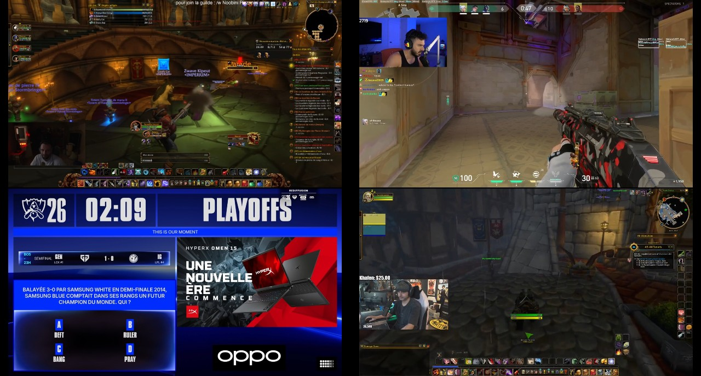
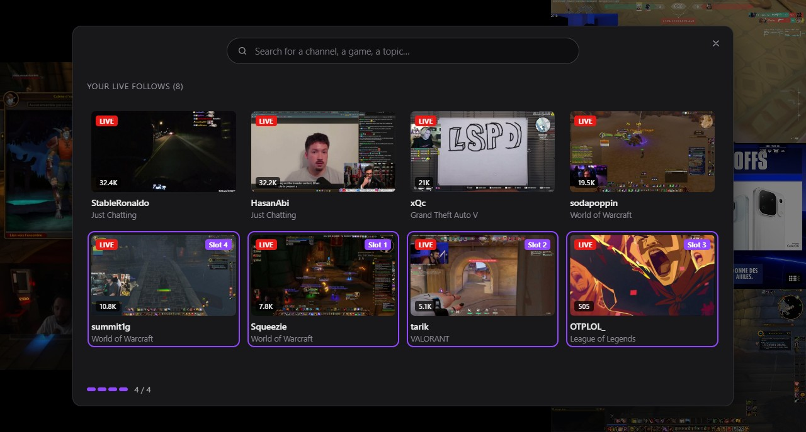
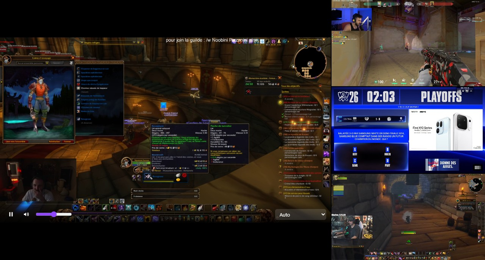
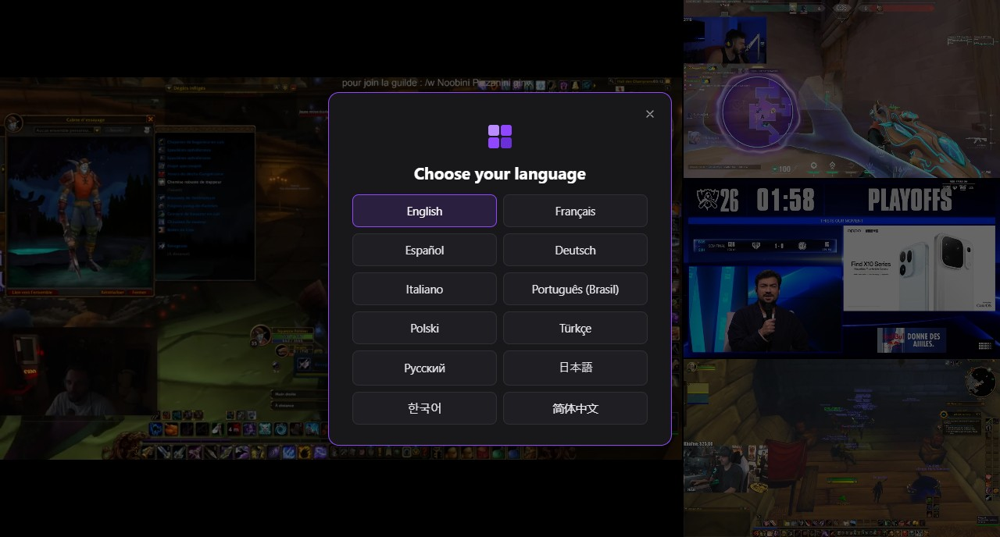

# Argos

Watch up to 4 live Twitch streams at the same time, on a single screen. Nothing but the videos: no chat, no menus, no bars.

Desktop app for Windows 10 and 11, available in 12 languages.



The name comes from Argos, the hundred-eyed giant of Greek mythology, who never closed all his eyes at once.

## Screenshots

**Choose the streams.** Your live follows, from the most watched to the least. One click puts the channel in the next slot, and the stream starts behind the window.



**Spotlight a stream.** Right-click a stream to make it big, the others stack up next to it. The controls (pause, volume, quality) only show up when the mouse moves over the stream.



**Pick your language.** Chosen at the first launch, and changed at any time by right-clicking the tab at the top of the window. The Twitch pages shown inside Argos follow it too.



## Features

- Up to 4 live streams in a single window. No interface stays on screen: the controls only show up when the mouse comes close.
- Sign in to your Twitch account once. Your live follows are listed so you can fill the slots in one click, and your offline follows stay visible apart.
- Search for any channel, game or topic, with the most relevant results first.
- Drag and drop to swap two streams, without reloading them.
- Spotlight: one stream big, the others stacked next to it. With 3 streams, it happens on its own.
- Separate settings for each stream: pause, volume, quality.
- 12 languages: English, French, Spanish, German, Italian, Brazilian Portuguese, Polish, Turkish, Russian, Japanese, Korean and Simplified Chinese. The whole app follows the language you pick, Twitch's sign-in and channel pages included.
- The perks of your account apply: no ads on the channels you subscribe to, or everywhere with Turbo. Argos does not block ads itself.

## Install

Download the installer, `Argos-Setup-1.1.0.exe`, from the [Releases](https://github.com/Uncher1/Argos/releases/latest) page and double-click it. It creates an **Argos** shortcut on the desktop and in the Start menu.

The app is not signed by a known publisher, so Windows may show "Windows protected your PC". Click **More info**, then **Run anyway**.

At the first launch, pick your language, then click **Log in with Twitch** and sign in with your Twitch username (or email) and password. Signing in with Google is not possible, because Google refuses it inside desktop apps. If your account has no password, click Twitch's "Trouble logging in?" link: Twitch emails you a link to create one.

## Privacy

- You sign in on Twitch's official page. Argos neither reads nor stores your password.
- Only one permission is asked of your account: seeing the channels you follow (`user:read:follows`).
- Your session stays on your PC, encrypted by Windows.
- Argos has no server: the app only talks to Twitch.

## What Argos does not do

- No chat, no replays or clips, no more than 4 streams.
- Windows only, and one Twitch account at a time.
- The slots are empty at every launch: that is on purpose.

## Build from source

You need Windows, Node.js 24 and npm 11.

1. Register an application in the [Twitch developer console](https://dev.twitch.tv/console/apps). It is free, but Twitch requires two-factor authentication on your account. Use `http://localhost/auth/callback` as the OAuth redirect URL. The full walkthrough is in [docs/setup.md](docs/setup.md).
2. Copy `config/twitch.example.json` to `config/twitch.json`, and replace the value with your application's Client ID.
3. Run these commands from the project folder:

```
npm install      # once
npm start        # runs Argos
npm test         # runs the tests
npm run demo     # demo mode: real Twitch players, simulated sign-in and follows
npm run dist     # builds the installer in dist/
```

The code is plain JavaScript, with Electron and Twitch's official player.

## License

[MIT](LICENSE). You can use, change and share Argos freely, as long as you keep the license.

Argos is not affiliated with or endorsed by Twitch. Twitch is a trademark of Twitch Interactive, Inc.
